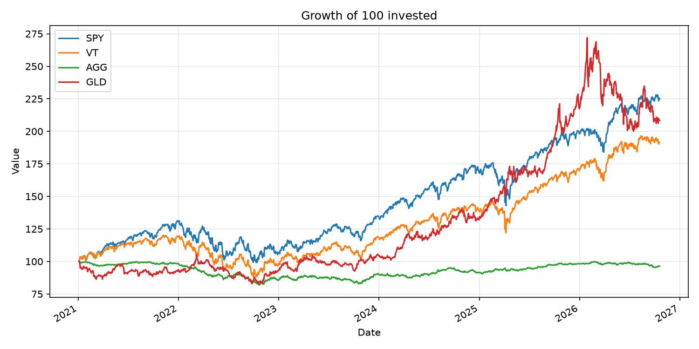
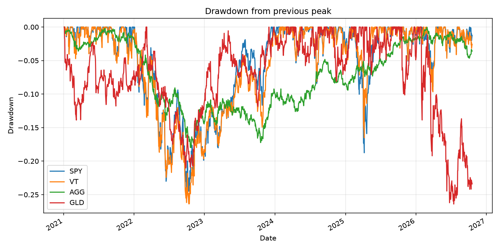
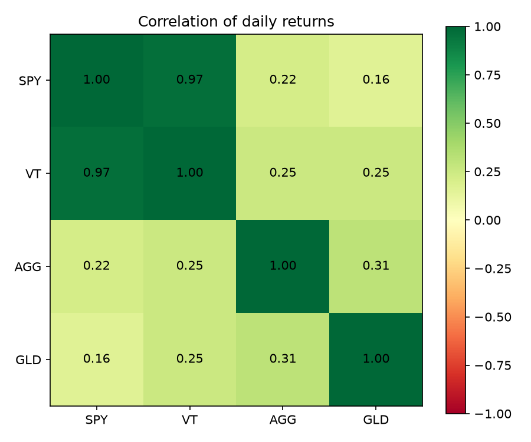

# Fund Analysis

A Python script that compares four ETFs on return, risk and drawdown, using public price data from Yahoo Finance.



## Results

These results use data from January 2021 to October 2026.

| Fund | Total return | Annual return (CAGR) | Volatility | Sharpe ratio | Max drawdown |
|---|---:|---:|---:|---:|---:|
| SPY | 125.3% | 15.1% | 16.6% | 0.75 | -24.5% |
| VT | 91.5% | 11.9% | 15.8% | 0.60 | -26.4% |
| AGG | -3.6% | -0.6% | 5.8% | -0.59 | -18.0% |
| GLD | 108.3% | 13.5% | 18.4% | 0.62 | -26.4% |

The Sharpe ratios assume a fixed risk-free rate of 3%.





## How to run it

```bash
pip install -r requirements.txt
python fund_analysis.py
```

The script saves the charts and a `summary.csv` file to the `output` folder.

To compare different funds or dates, change the settings at the top of `fund_analysis.py`.

This project is for learning and isn't investment advice.
